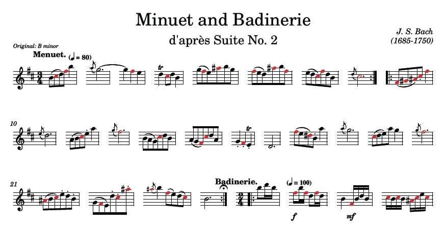

# Measure Separator

**MuseScore Studioの五線を小節ごとに区切る、初見演奏・練習向けのプラグインです。**

Measure SeparatorはMuseScore標準の水平フレームを使い、指定した小節数ごとに五線が途切れる余白を入れます。既定値は1小節ごとに3.0 spです。音符や休符を追加せず、余白の幅と間隔を指定できます。

*J. S. Bach《Minuet and Badinerie》の譜例。余白にはMeasure Separator、変化音の色分けには別プラグインのAccidental Colorを使用しています。*

## 開発の背景

文章の単語間にある空白のように、楽譜にも視覚的な区切りがあると、演奏者はまとまりを見つけやすくなるでしょうか。Measure Separatorは、音楽記譜の視覚的な分節を扱った次の研究に着想を得ています。

| 原典 | 論文で調べたこと |
| --- | --- |
| Stenberg & Cross（2019） | 打楽器専攻の学生がマリンバで初見演奏。短いフレーズ内のまとまりを五線にまたがる余白で分けた条件では、最初の演奏の誤りが通常譜より少なくなりました。 [Scientific Reports](https://doi.org/10.1038/s41598-019-41445-1) |
| Duncan, Ness & Cross（2026） | ピアニスト25名を対象に、音楽的なまとまりを余白で示した譜面を検証。参加者の初見演奏能力の限界に近い難易度で、誤り数が約19%減少したと報告しています。 [Musicae Scientiae](https://doi.org/10.1177/10298649261419805) · [著者最終稿](https://doi.org/10.17863/CAM.123990) |

論文では音楽的なまとまりを使って余白の位置を決めています。本プラグインでは利用者が指定した小節数を基準にします。この区切り方や、譜例にある色分けによる初見演奏や認知負荷への効果は未検証です。約19%は2026年の実験条件での結果です。

## インストール

**動作確認環境はWindows 11とMuseScore Studio 4.7.7です。**

1. GitHubの **Code → Download ZIP** からダウンロードし、展開します。
2. `MeasureSeparator.qml` と `MeasureSeparator.png` をMuseScoreのプラグインフォルダーにコピーします。場所はMuseScoreの **環境設定 → フォルダー** で確認できます。
3. **ホーム → プラグイン** でMeasure Separatorを有効にします。
4. 楽譜を開き、**プラグイン → Measure Separator** から **適用** を押します。元に戻すには **分割解除** を使います。

**1か所だけ区切る場合**は、譜面上で小節を1つ選択し、［適用範囲］で［選択した1小節の直前］または［選択した1小節の直後］を選んで［適用］を押します。指定した位置に空白を追加し、すでにMeasure Separatorで空白を入れている場合はその幅を更新します。ほかの余白は維持されます。

詳細は[インストール手順](INSTALL.md)と[動作検証結果](TEST_RESULTS.md)をご覧ください。リンク済みパートを含むスコアは、対象パートを独立した譜面として開いてください。改行・改ページの境界や、複数小節をまとめた反復記号の途中などでは分割を省略します。

[Before / Afterの比較](Examples/BeforeAfter.png) · [変更履歴](CHANGELOG.md) · [GPL-3.0-only](LICENSE)

## English

Measure Separator is a MuseScore Studio plugin that adds adjustable gaps between measures for sight-reading practice. It uses native horizontal frames and lets you apply or remove the spacing without adding notes or rests. The default is 3.0 staff spaces between consecutive measures. To place a single gap, select one measure and use the Before or After option in Scope.

The design draws on research on visual grouping in notation. Those studies placed gaps at musical groups, while this plugin uses a configurable measure interval. Its effect on sight-reading accuracy or cognitive load has yet to be evaluated. The score above shows Measure Separator alongside the separate Accidental Color plugin.

Tested on Windows 11 with MuseScore Studio 4.7.7. Copy `MeasureSeparator.qml` and `MeasureSeparator.png` to your MuseScore plugins folder, enable Measure Separator in Home → Plugins, and open it from the Plugins menu.
